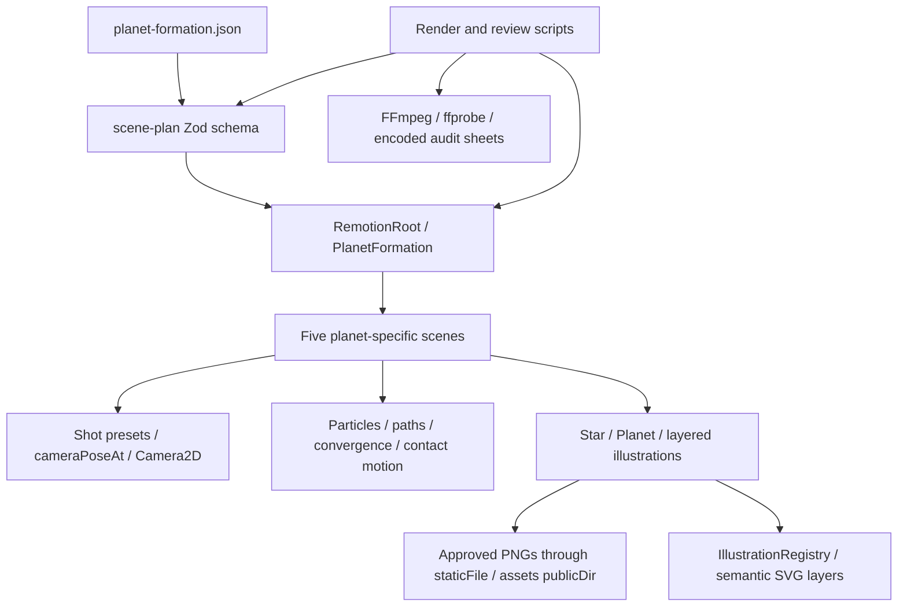

# M2.1 architecture audit

Audit completed before implementation, against approved baseline `a56e228ebe1f3dde6e8daf03c5057e1f06c34572`.

## Dependency map

## Findings

| Area | Reusable parts | Coupling / assumptions |
| --- | --- | --- |
| Components | Camera2D, seeded particles, text, backgrounds, layered illustration wrappers | AnimatedText defaults to planet title and fixed 1080×1920 placement; SpaceBackground and several SVG canvases have fixed dimensions |
| Scene implementations | Frame-local rendering and explicit Sequence scheduling | All five scenes contain planet narrative, fixed positions, colors, emphasis, handoffs, radii, effects and duration-relative constants |
| Camera | cameraTransform, cameraPoseAt, shot presets | Default viewport 540/960; Catmull interpolation assumes sensibly spaced keys; some preset metadata is descriptive |
| Motion | Seeded RNG/particles, ellipse paths, easing, convergence | Contact/growth and rocky silhouette utilities are domain-specific; some effects use fixed pixel sizes/frame constants |
| Illustration loading | Img/staticFile, local publicDir, layered semantic roles | Registry describes illustration structure, not file references; Sun and planet paths are embedded in their implementations; lighting/alpha geometry is artwork-specific |
| Plan schema | Zod, duplicate-ID checks, contiguous explicit start frames | Fixed enum of five domain scenes; no general asset registry, template-specific payloads or operational camera/motion controls |
| Rendering | Local bundle, H.264, unique jobs, controlled concurrency | scripts/lib imports the planet plan; main composition and job naming are fixed; Chrome path is macOS-specific |
| Verification | ffprobe, black detection, chronological extraction | Fixed 450 frames, 15 seconds, 30 FPS, 1080×1920 and four boundaries; asset checks are asserted rather than file-system audits; pixel scene identity still requires a person |
| Tests | Determinism, timeline, asset integrity, matched handoffs | Good baseline protection, but no generic schema, registry or preset contracts |

## Recommendations and implementation boundary

1. Preserve the approved composition and its schema unchanged. Use an explicitly versioned legacy adapter and leave its rendering branch intact. Render the original before and after, compare decoded full-resolution frames, and retain approved asset hashes.
2. Add an isolated generic storyboard engine alongside the legacy path. Array order is authoritative; derive contiguous frame ranges rather than accepting inconsistent duplicate start times. Validate template payloads through a discriminated union and reject unknown fields/names/references.
3. Separate immutable asset-file metadata from illustration semantics. Validate safe local PNG/SVG/WebP paths, unique IDs, declared dimensions/style/alpha, and actual file existence before rendering. No runtime code or remote URLs in JSON.
4. Provide five focused template compositions with shared subject rendering, captions and background. Use normalized layout coordinates so format changes do not require fixed pixel edits. Keep topic-specific Sun/planet formation behavior out of generic templates.
5. Reuse existing easing, camera interpolation, orbit and seeded convergence helpers behind validated presets. Scene-local frame controls motion; explicit numeric seed controls variation. Match camera/motion endpoints and use boundary-safe subject entrances/exits for independently arranged scenes.
6. Add a generic composition with metadata derived from input data and a generic render/verification command. Keep legacy scripts stable; avoid a risky simultaneous rewrite. Generic verification must derive duration/boundaries from data and verify decoded samples and real asset files.
7. Prove all five templates in a short architecture demo using the approved assets. This is not a second educational video. Document flattened artwork, layout limits, cut/transition semantics and the limits of automated checks.

No AI agents, scriptwriting, image generation, narration, publishing, dashboard or M2.2 work is needed. Do not move legacy files simply to match a directory diagram.
