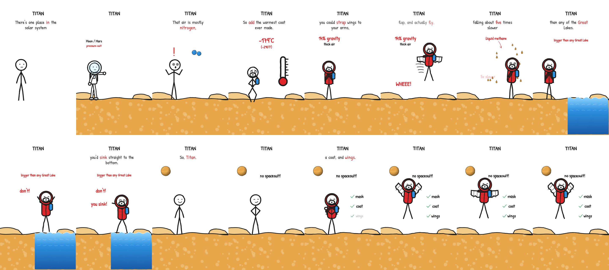

# M3.4 — Titan Short (9:16) from the approved pilot

_2026-11-16 · branch `claude/m3-4-shorts` (from `claude/m3-3-paint-pilot` @ `c146670`) · **complete**. Human viewing review on a phone is still pending._

## What was delivered

| Item | Where | Notes |
|---|---|---|
| Shared authoring helpers | `scripts/authoring/paintkit.py` | The figure, planet, prop, note, rain, bubbles, molecule and scene builders moved out of the pilot generator. The pilot board regenerates **byte-identical**. `molecule()` takes an `aspect` parameter and `rain()` takes a `top` parameter, so the same builders work in any format. |
| Short generator | `scripts/authoring/build-titan-short-storyboard.py` → `storyboards/titan-short.json` | 1080×1920. It imports the pilot's story, beat lengths, sound cues and camera, so only the layout differs. Every story moment is still a word anchor, so the approved take lines up without retiming. |
| Shorts caption style | `config/caption-styles/shorts-paint.json` | Burned-in captions with per-word highlight: dark handwriting, white outline and a red active word. They sit under the title, clear of the right-hand button column. |
| Caption spacing fix | `src/captions/renderer.tsx` | Outline captions add `.14em` word spacing, and the active (scaled) word gets a small side margin. Before the fix, spaces visibly collapsed with handwritten fonts ("itpresseson"). The fix is generic and helps every outline-caption video. |
| Timestamp-drift guard | `scripts/assemble-job.ts`, `scripts/render-job-frames.ts` | Assemble now warns when segments are not whole seconds long. Root cause found here: 100-frame segments at 30 fps (3.333… s) each lose a fraction of a microsecond in the concat demuxer. After about 17 segments that exceeds the strict decoded-timestamp check. Use 120-frame (or any multiple of fps) chunks. |
| Tests | `src/tests/titan-short.test.tsx` (4 tests) | The tests check four things: same scenes, cues and sounds as the pilot; every anchor resolves; notes and figures stay out of the Shorts UI zones; the caption style is valid. |
| Final Short (gitignored) | `jobs/m3-4-short/output/narrated-animation.mp4` + `upload/` | 64.0 s, 1080×1920, H.264/AAC, sha256 `65ac88dcccc29b56…`. |

## Verification

- `tsc --noEmit`: clean. `vitest`: 27 files / 383 tests pass.
- Cached-story verifier: **all checks pass**:
  - decoded timestamps exact;
  - narration matches the approved performance;
  - −14.9 LUFS (target −14), true peak −2.3 dBTP;
  - music ducked by 17.4 dB under speech;
  - phrase clarity ≥ 0.955 on all 36 phrases;
  - all 167 words captioned;
  - mobile-safe caption layout.
- Paid requests: **0**. This reuses the approved M3.3 narration (hash checked).
- Render: 18 segments at 0.66 s per frame per process in the VM, about 6 minutes of wall time with 4–5 parallel processes.

## Layout rules used (reusable for every future Short)

YouTube draws its own interface over a Short. The layout keeps story content clear of it:

- top ~7%: search and camera icons;
- bottom ~22%: title, channel and music;
- right column from ~50% to ~78% height: like, comment and share buttons.

Story content stays in x 60–900 px and y 440–1460 px. The ground fills the bottom zone (decorative only). Captions sit in a band at 14–21% height under a small title. `docs/m3-4/safe-zone-check.jpg` shows the zones as blue overlays. That image comes from the second still pass; three later fixes are listed below.

## Review findings fixed during the milestone

1. The opening 2 s was an empty page because the figure popped in on "step". On Shorts the first frame decides whether people swipe away, so the figure is now on screen from frame 0.
2. The flying figure crossed the "thick air" note. The flight path now goes further right and less high.
3. "you sink!" was drawn on top of the sinking figure. The label moved to the empty left side.
4. Methane-rain labels collided with the drops. The drops now start below the labels.
5. Caption word spacing (see above).

## Honest quality assessment

- **Works:**
  - legible captions on a phone;
  - every scene reads on its own in portrait;
  - the gags (squeeze, scream, coat, wings, sinking) all land;
  - sound design is unchanged from the pilot.
- **Weaker than a purpose-made Short:**
  - The script was written for 16:9. A native Short would open on the punchline visual ("no spacesuit?!") in the first second and cut the slower lines.
  - Figures are about 30% of frame height. That's fine, but top Shorts animators fill more of the frame and use more camera push-ins.
  - The bottom fifth is ground under the UI, which is correct but adds no information.
- **Duplication caveat:** the Short and the 16:9 video tell the same 64-second story. This is normal and allowed. The Short's "Related video" link should point to the 16:9 upload so the two feed each other.

## Technical debt

- Layout coordinates are still hand-placed for each format. A third format, or a long episode, would benefit from a layout solver (zones + collision checks) that places notes automatically.
- `preview-stills` and the chunk runner are still run by hand in 4–5 parallel calls. A small script that plans whole-second chunks would remove the drift trap completely.
