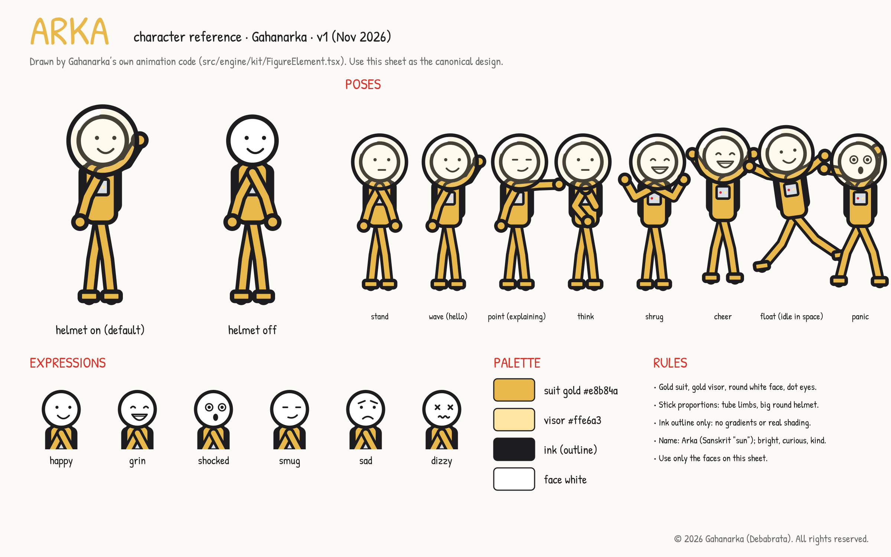

# Arka: character reference



Arka is Gahanarka's mascot: a curious girl astronaut in a gold suit, named after the Sun (Arka is Sanskrit for "sun").

## Who Arka is (decided 19 Nov 2026)

- **She/her.** Arka is a girl; her voice (ElevenLabs, voice `cgSgspJ2msm6clMCkdW9`) has been the same since Ep 2, so it stays.
- **Role:** she asks the questions viewers are thinking, makes the jokes, and from Ep 5 on ends each episode with the next question (see `docs/CONTENT_PLAN.md`).
- **In scripts:** the narrator calls her by name ("Sorry, Arka"); use "she" in descriptions, comments and docs.

## Why this sheet is the canonical design

- **Who made it:** the sheet is drawn by the channel's own animation code (`src/engine/kit/FigureElement.tsx`), the same component the videos use. No AI imagery is involved, so the character rests on human-authored work.
- **Thumbnails:** the AI-generated Arka in earlier thumbnails (OpenAI, M3.5b) is a variation, not the reference. Render Arka for future thumbnails from our own code, and use AI only for backgrounds and effects.
- **History:** git keeps the dated record of the design's development.

## Regenerate

```
npx tsx scripts/brand/arka-sheet.tsx docs/brand/arka-reference-sheet.svg
rsvg-convert docs/brand/arka-reference-sheet.svg -o docs/brand/arka-reference-sheet.png   # needs the Patrick Hand font installed
```

## Specification

- **Colours:** suit gold `#e8b84a`, visor `#ffe6a3`, theme ink outline, white face.
- **Poses:** stand, wave, point, think, shrug, cheer, float, panic (plus the other `POSE_IDS` in `src/engine/kit/figure.ts`).
- **Expressions:** happy, grin, shocked, smug, sad, dizzy (plus the other `FACE_IDS`).
- **Helmet:** on by default; off for close-ups and expressions.

## Where Arka is used on the channel

- **Profile picture** (since 19 Nov 2026): `arka-watermark.png` (600×600), replacing the gold "G".
- **Video watermark:** still the older stick-figure `jobs/branding/gahanarka-watermark-150.png` (as of 19 Nov 2026).
